# Results

Generated by `python main.py report` from `outputs/results/summary/*.csv`. Every number below comes
from an actual run. Values are **mean [95% CI]** across independent seeds (Student t).
Experiments without data are marked **pending**. Interpretation is in [report.md](report.md).

Hardware: macOS-26.4.1-arm64-arm-64bit, 18 CPU cores, Python 3.11.16, PyTorch 2.15.0, MPS available: True. Code version: `f64899b-dirty`.

## E1: Static scaling

### Density 0.15

| N | planner | time ms | expansions | peak KiB | cost / optimal | n |
|---|---|---|---|---|---|---|
| 10 | A* (Manhattan) | 0.0316 [0.0286, 0.0345] | 23 [20.8, 25.3] | 12 [11.3, 12.7] | 1 | 30 |
| 10 | BFS | 0.0779 [0.0767, 0.079] | 84.7 [84.5, 84.9] | 10.5 [10.4, 10.5] | 1 | 30 |
| 10 | D* Lite (initial) | 0.606 [0.577, 0.636] | 70 [66.4, 73.5] | 21.8 [21.2, 22.4] | 1 | 30 |
| 10 | Dijkstra | 0.0898 [0.0878, 0.0918] | 84.7 [84.5, 84.9] | 22.7 [22.6, 22.7] | 1 | 30 |
| 20 | A* (Manhattan) | 0.0949 [0.0794, 0.11] | 66.2 [54.9, 77.4] | 29.3 [25.5, 33] | 1 | 30 |
| 20 | BFS | 0.308 [0.305, 0.31] | 339 [338, 340] | 31.6 [31.6, 31.7] | 1 | 30 |
| 20 | D* Lite (initial) | 2.47 [2.36, 2.57] | 262 [250, 274] | 73.2 [70.4, 76] | 1 | 30 |
| 20 | Dijkstra | 0.367 [0.364, 0.37] | 339 [338, 340] | 85.6 [85.6, 85.7] | 1 | 30 |
| 30 | A* (Manhattan) | 0.17 [0.146, 0.193] | 116 [99.7, 132] | 49.6 [44.7, 54.6] | 1 | 30 |
| 30 | BFS | 0.695 [0.693, 0.698] | 764 [764, 764] | 94.4 [94.4, 94.4] | 1 | 30 |
| 30 | D* Lite (initial) | 5.65 [5.46, 5.85] | 583 [563, 604] | 157 [151, 163] | 1 | 30 |
| 30 | Dijkstra | 0.849 [0.846, 0.852] | 764 [764, 764] | 180 [180, 180] | 1 | 30 |
| 50 | A* (Manhattan) | 0.372 [0.323, 0.421] | 248 [215, 281] | 106 [92.4, 119] | 1 | 30 |
| 50 | BFS | 1.91 [1.91, 1.92] | 2,123 [2,122, 2,123] | 193 [193, 193] | 1 | 30 |
| 50 | D* Lite (initial) | 15.7 [15.2, 16.3] | 1,607 [1,552, 1,662] | 425 [416, 435] | 1 | 30 |
| 50 | Dijkstra | 2.4 [2.39, 2.4] | 2,123 [2,122, 2,123] | 444 [444, 444] | 1 | 30 |
| 70 | A* (Manhattan) | 0.64 [0.567, 0.713] | 422 [374, 471] | 171 [153, 188] | 1 | 30 |
| 70 | BFS | 3.76 [3.75, 3.77] | 4,162 [4,162, 4,163] | 378 [378, 378] | 1 | 30 |
| 70 | D* Lite (initial) | 31.7 [31, 32.4] | 3,228 [3,155, 3,302] | 839 [829, 848] | 1 | 30 |
| 70 | Dijkstra | 4.76 [4.75, 4.77] | 4,162 [4,162, 4,163] | 749 [748, 749] | 1 | 30 |
| 100 | A* (Manhattan) | 1.09 [0.989, 1.19] | 710 [644, 777] | 271 [255, 286] | 1 | 30 |
| 100 | BFS | 7.69 [7.68, 7.7] | 8,494 [8,493, 8,495] | 760 [760, 760] | 1 | 30 |
| 100 | D* Lite (initial) | 65.6 [64.3, 66.8] | 6,622 [6,498, 6,746] | 1,673 [1,658, 1,687] | 1 | 30 |
| 100 | Dijkstra | 9.93 [9.91, 9.95] | 8,494 [8,493, 8,495] | 1,761 [1,761, 1,761] | 1 | 30 |

### Density 0.3

| N | planner | time ms | expansions | peak KiB | cost / optimal | n |
|---|---|---|---|---|---|---|
| 10 | A* (Manhattan) | 0.0352 [0.0316, 0.0388] | 26.3 [23.4, 29.2] | 11.7 [11.1, 12.4] | 1 | 30 |
| 10 | BFS | 0.0585 [0.0557, 0.0612] | 61.6 [59.1, 64.2] | 8.98 [8.77, 9.19] | 1 | 30 |
| 10 | D* Lite (initial) | 0.361 [0.338, 0.384] | 44.1 [41.1, 47.2] | 15.9 [15.2, 16.7] | 1 | 30 |
| 10 | Dijkstra | 0.0638 [0.0607, 0.0669] | 61.6 [59.1, 64.2] | 13.6 [13.4, 13.8] | 1 | 30 |
| 20 | A* (Manhattan) | 0.111 [0.0899, 0.132] | 84.6 [68.3, 101] | 30.3 [25.8, 34.7] | 1 | 30 |
| 20 | BFS | 0.233 [0.225, 0.24] | 258 [250, 266] | 27.4 [27.1, 27.7] | 1 | 30 |
| 20 | D* Lite (initial) | 1.11 [1.02, 1.21] | 133 [122, 145] | 43.2 [40.1, 46.2] | 1 | 30 |
| 20 | Dijkstra | 0.268 [0.259, 0.277] | 258 [250, 266] | 49.6 [49.1, 50.1] | 1 | 30 |
| 30 | A* (Manhattan) | 0.223 [0.171, 0.276] | 163 [124, 201] | 54.5 [44.1, 64.9] | 1 | 30 |
| 30 | BFS | 0.527 [0.518, 0.536] | 590 [579, 601] | 54.9 [54.3, 55.4] | 1 | 30 |
| 30 | D* Lite (initial) | 2.63 [2.34, 2.91] | 310 [274, 346] | 93.3 [84.8, 102] | 1 | 30 |
| 30 | Dijkstra | 0.637 [0.625, 0.649] | 590 [579, 601] | 118 [118, 119] | 1 | 30 |
| 50 | A* (Manhattan) | 0.556 [0.45, 0.661] | 394 [319, 468] | 129 [109, 148] | 1 | 30 |
| 50 | BFS | 1.49 [1.48, 1.5] | 1,694 [1,682, 1,706] | 186 [186, 186] | 1 | 30 |
| 50 | D* Lite (initial) | 5.95 [5.08, 6.81] | 698 [592, 804] | 200 [175, 225] | 1 | 30 |
| 50 | Dijkstra | 1.86 [1.85, 1.88] | 1,694 [1,682, 1,706] | 421 [420, 421] | 1 | 30 |
| 70 | A* (Manhattan) | 1 [0.73, 1.27] | 699 [510, 887] | 213 [166, 260] | 1 | 30 |
| 70 | BFS | 2.94 [2.93, 2.95] | 3,343 [3,332, 3,355] | 368 [368, 369] | 1 | 30 |
| 70 | D* Lite (initial) | 10.6 [8.76, 12.4] | 1,236 [1,015, 1,457] | 346 [295, 396] | 1 | 30 |
| 70 | Dijkstra | 3.72 [3.71, 3.74] | 3,343 [3,332, 3,355] | 709 [709, 709] | 1 | 30 |
| 100 | A* (Manhattan) | 2.27 [1.6, 2.95] | 1,550 [1,097, 2,004] | 434 [335, 533] | 1 | 30 |
| 100 | BFS | 6.04 [6.03, 6.06] | 6,835 [6,821, 6,849] | 734 [734, 734] | 1 | 30 |
| 100 | D* Lite (initial) | 17.5 [15, 20] | 2,027 [1,727, 2,326] | 574 [505, 642] | 1 | 30 |
| 100 | Dijkstra | 7.75 [7.73, 7.77] | 6,835 [6,821, 6,849] | 1,669 [1,668, 1,669] | 1 | 30 |

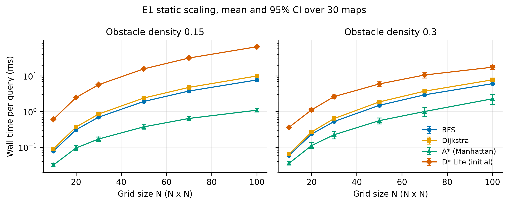
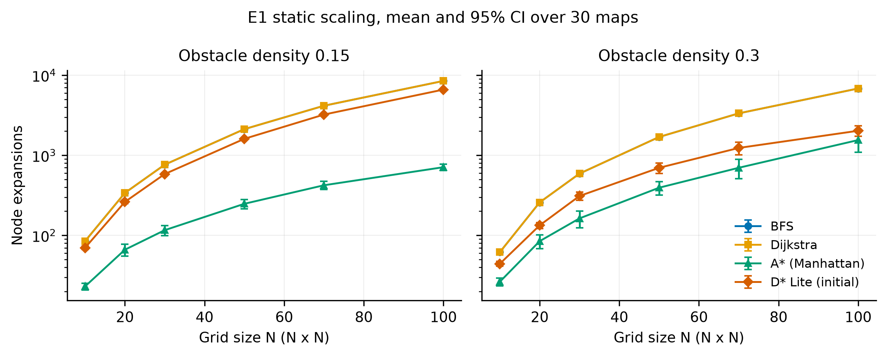
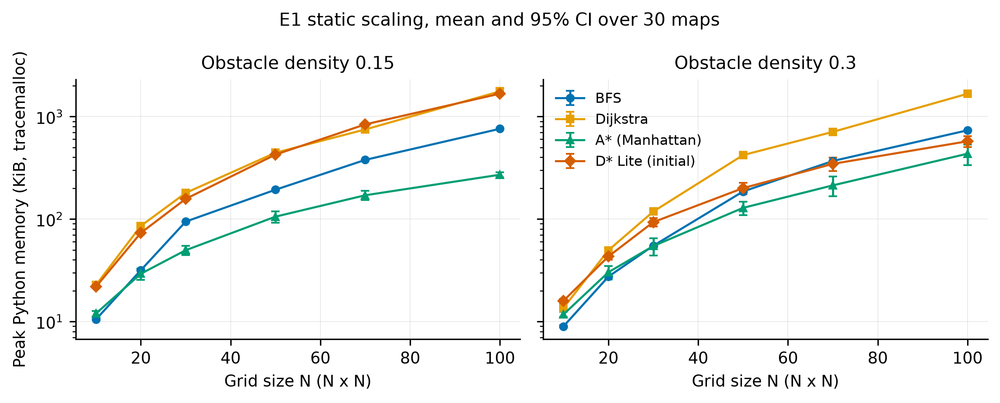

## E2: Heuristic quality (A*)

| density | N | heuristic | expansions | time ms | cost / optimal | fraction optimal | n |
|---|---|---|---|---|---|---|---|
| 0.15 | 10 | 1.5 x Manhattan | 22.6 [20.7, 24.5] | 0.0321 [0.0291, 0.0351] | 1.011 [0.9985, 1.024] | 0.9 | 30 |
| 0.15 | 10 | Manhattan | 23 [20.8, 25.3] | 0.0332 [0.0299, 0.0365] | 1 [1, 1] | 1 | 30 |
| 0.15 | 10 | h=0 | 84.7 [84.5, 84.9] | 0.0982 [0.0972, 0.0992] | 1 [1, 1] | 1 | 30 |
| 0.15 | 20 | 1.5 x Manhattan | 51.1 [47.4, 54.9] | 0.0725 [0.0674, 0.0776] | 1.047 [1.031, 1.064] | 0.333 | 30 |
| 0.15 | 20 | Manhattan | 66.2 [54.9, 77.4] | 0.0959 [0.0803, 0.111] | 1 [1, 1] | 1 | 30 |
| 0.15 | 20 | h=0 | 339 [338, 340] | 0.4 [0.397, 0.403] | 1 [1, 1] | 1 | 30 |
| 0.15 | 30 | 1.5 x Manhattan | 82.5 [74.1, 90.9] | 0.119 [0.109, 0.13] | 1.059 [1.043, 1.075] | 0.1 | 30 |
| 0.15 | 30 | Manhattan | 116 [99.7, 132] | 0.169 [0.147, 0.192] | 1 [1, 1] | 1 | 30 |
| 0.15 | 30 | h=0 | 764 [764, 764] | 0.918 [0.914, 0.921] | 1 [1, 1] | 1 | 30 |
| 0.15 | 50 | 1.5 x Manhattan | 145 [130, 160] | 0.214 [0.193, 0.234] | 1.059 [1.046, 1.071] | 0.0667 | 30 |
| 0.15 | 50 | Manhattan | 248 [215, 281] | 0.372 [0.323, 0.422] | 1 [1, 1] | 1 | 30 |
| 0.15 | 50 | h=0 | 2,123 [2,122, 2,123] | 2.6 [2.59, 2.6] | 1 [1, 1] | 1 | 30 |
| 0.15 | 70 | 1.5 x Manhattan | 189 [177, 201] | 0.284 [0.267, 0.302] | 1.072 [1.062, 1.082] | 0 | 30 |
| 0.15 | 70 | Manhattan | 422 [374, 471] | 0.642 [0.568, 0.717] | 1 [1, 1] | 1 | 30 |
| 0.15 | 70 | h=0 | 4,162 [4,162, 4,163] | 5.16 [5.15, 5.16] | 1 [1, 1] | 1 | 30 |
| 0.15 | 100 | 1.5 x Manhattan | 282 [270, 294] | 0.432 [0.415, 0.449] | 1.083 [1.076, 1.09] | 0 | 30 |
| 0.15 | 100 | Manhattan | 710 [644, 777] | 1.1 [0.998, 1.2] | 1 [1, 1] | 1 | 30 |
| 0.15 | 100 | h=0 | 8,494 [8,493, 8,495] | 10.7 [10.7, 10.7] | 1 [1, 1] | 1 | 30 |
| 0.3 | 10 | 1.5 x Manhattan | 25.5 [22.6, 28.5] | 0.0346 [0.0309, 0.0382] | 1.007 [0.9969, 1.018] | 0.933 | 30 |
| 0.3 | 10 | Manhattan | 26.3 [23.4, 29.2] | 0.0358 [0.0323, 0.0393] | 1 [1, 1] | 1 | 30 |
| 0.3 | 10 | h=0 | 61.6 [59.1, 64.2] | 0.0693 [0.0664, 0.0722] | 1 [1, 1] | 1 | 30 |
| 0.3 | 20 | 1.5 x Manhattan | 73.2 [60.9, 85.5] | 0.0964 [0.081, 0.112] | 1.026 [1.014, 1.038] | 0.567 | 30 |
| 0.3 | 20 | Manhattan | 84.6 [68.3, 101] | 0.116 [0.0955, 0.137] | 1 [1, 1] | 1 | 30 |
| 0.3 | 20 | h=0 | 258 [250, 266] | 0.292 [0.283, 0.3] | 1 [1, 1] | 1 | 30 |
| 0.3 | 30 | 1.5 x Manhattan | 111 [95, 128] | 0.148 [0.128, 0.169] | 1.038 [1.018, 1.058] | 0.533 | 30 |
| 0.3 | 30 | Manhattan | 163 [124, 201] | 0.222 [0.169, 0.274] | 1 [1, 1] | 1 | 30 |
| 0.3 | 30 | h=0 | 590 [579, 601] | 0.687 [0.674, 0.699] | 1 [1, 1] | 1 | 30 |
| 0.3 | 50 | 1.5 x Manhattan | 217 [184, 251] | 0.299 [0.254, 0.344] | 1.054 [1.032, 1.076] | 0.2 | 30 |
| 0.3 | 50 | Manhattan | 394 [319, 468] | 0.557 [0.452, 0.663] | 1 [1, 1] | 1 | 30 |
| 0.3 | 50 | h=0 | 1,694 [1,682, 1,706] | 2.02 [2, 2.03] | 1 [1, 1] | 1 | 30 |
| 0.3 | 70 | 1.5 x Manhattan | 300 [255, 346] | 0.415 [0.355, 0.476] | 1.064 [1.05, 1.077] | 0.0333 | 30 |
| 0.3 | 70 | Manhattan | 699 [510, 887] | 1 [0.73, 1.27] | 1 [1, 1] | 1 | 30 |
| 0.3 | 70 | h=0 | 3,343 [3,332, 3,355] | 4.02 [4.01, 4.04] | 1 [1, 1] | 1 | 30 |
| 0.3 | 100 | 1.5 x Manhattan | 444 [397, 490] | 0.631 [0.568, 0.695] | 1.066 [1.054, 1.079] | 0 | 30 |
| 0.3 | 100 | Manhattan | 1,550 [1,097, 2,004] | 2.3 [1.62, 2.98] | 1 [1, 1] | 1 | 30 |
| 0.3 | 100 | h=0 | 6,835 [6,821, 6,849] | 8.38 [8.35, 8.41] | 1 [1, 1] | 1 | 30 |

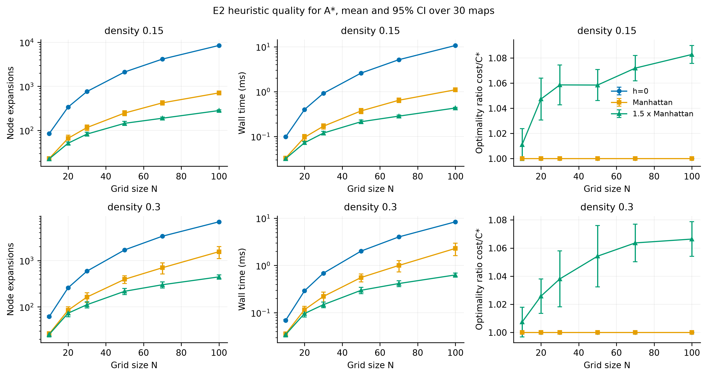

## DQN / Double DQN training (shared by E3-E5)

| algorithm | train_seed | observation | device | train_time_s | env_steps | gradient_steps | episodes | final_success_rate | converged | episodes_to_convergence |
|---|---|---|---|---|---|---|---|---|---|---|
| dqn | 0 | local | mps | 1,026 | 500000 | 124501 | 12173 | 0.4 | False | nan |
| dqn | 1 | local | mps | 1,300 | 500000 | 124501 | 10654 | 0.34 | False | nan |
| dqn | 2 | local | mps | 982 | 500000 | 124501 | 12083 | 0.46 | False | nan |
| double_dqn | 0 | local | mps | 531 | 500000 | 124501 | 13483 | 0.44 | False | nan |
| double_dqn | 1 | local | mps | 532 | 500000 | 124501 | 13806 | 0.36 | False | nan |
| double_dqn | 2 | local | mps | 532 | 500000 | 124501 | 14150 | 0.4 | False | nan |

`final_success_rate` = greedy success on 50 held-out validation maps at the end of training.
DQN rows trained concurrently with E1/E2/E6 (CPU contention); Double DQN rows trained alone. See methodology §5.

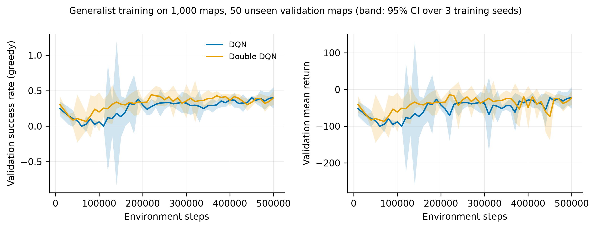

## E3: Dynamic obstacles and crossover

| N | change every k | method | computation ms / episode | success | path / static optimum | replans | n |
|---|---|---|---|---|---|---|---|
| 10 | 1 | A* (replan on change) | 0.091 [0.0695, 0.112] | 1 [1, 1] | 1.06 [1.02, 1.1] | 7.63 [6.45, 8.82] | 30 |
| 10 | 1 | A* (replan when blocked) | 0.026 [0.0199, 0.0322] | 1 [1, 1] | 1.09 [1.02, 1.15] | 0.633 [0.316, 0.951] | 30 |
| 10 | 1 | D* Lite | 0.763 [0.601, 0.925] | 1 [1, 1] | 1.07 [1.02, 1.11] | 7.7 [6.5, 8.9] | 30 |
| 10 | 1 | DQN | 2.42 [1.85, 3] | 0.922 [0.866, 0.979] | 2.91 [2.24, 3.58] | n/a | 90 |
| 10 | 1 | Double DQN | 2.01 [1.52, 2.5] | 0.933 [0.881, 0.986] | 2.48 [1.83, 3.12] | n/a | 90 |
| 10 | 2 | A* (replan on change) | 0.0547 [0.0419, 0.0675] | 1 [1, 1] | 1.06 [0.999, 1.12] | 3.6 [2.92, 4.28] | 30 |
| 10 | 2 | A* (replan when blocked) | 0.022 [0.0174, 0.0265] | 1 [1, 1] | 1.05 [0.991, 1.11] | 0.367 [0.0492, 0.684] | 30 |
| 10 | 2 | D* Lite | 0.449 [0.344, 0.554] | 1 [1, 1] | 1.06 [0.999, 1.12] | 3.6 [2.92, 4.28] | 30 |
| 10 | 2 | DQN | 2.4 [1.86, 2.94] | 0.922 [0.866, 0.979] | 3.01 [2.28, 3.74] | n/a | 90 |
| 10 | 2 | Double DQN | 2.39 [1.83, 2.94] | 0.911 [0.851, 0.971] | 2.88 [2.25, 3.51] | n/a | 90 |
| 10 | 5 | A* (replan on change) | 0.0327 [0.0253, 0.0402] | 1 [1, 1] | 1.05 [0.975, 1.13] | 1.33 [0.617, 2.05] | 30 |
| 10 | 5 | A* (replan when blocked) | 0.023 [0.017, 0.029] | 1 [1, 1] | 1.06 [0.979, 1.14] | 0.467 [-0.225, 1.16] | 30 |
| 10 | 5 | D* Lite | 0.274 [0.209, 0.339] | 1 [1, 1] | 1.05 [0.975, 1.13] | 1.33 [0.617, 2.05] | 30 |
| 10 | 5 | DQN | 3.02 [2.4, 3.64] | 0.867 [0.795, 0.938] | 3.82 [2.95, 4.69] | n/a | 90 |
| 10 | 5 | Double DQN | 3.04 [2.37, 3.72] | 0.856 [0.782, 0.93] | 3.71 [2.86, 4.55] | n/a | 90 |
| 10 | 10 | A* (replan on change) | 0.0251 [0.018, 0.0321] | 1 [1, 1] | 1.1 [0.943, 1.25] | 0.833 [-0.526, 2.19] | 30 |
| 10 | 10 | A* (replan when blocked) | 0.0223 [0.0159, 0.0287] | 1 [1, 1] | 1.1 [0.943, 1.25] | 0.7 [-0.663, 2.06] | 30 |
| 10 | 10 | D* Lite | 0.212 [0.15, 0.273] | 1 [1, 1] | 1.1 [0.943, 1.25] | 0.833 [-0.526, 2.19] | 30 |
| 10 | 10 | DQN | 3.93 [3.25, 4.61] | 0.844 [0.768, 0.921] | 4.96 [4.04, 5.88] | n/a | 90 |
| 10 | 10 | Double DQN | 3.58 [2.85, 4.31] | 0.8 [0.716, 0.884] | 4.42 [3.46, 5.39] | n/a | 90 |
| 10 | 20 | A* (replan on change) | 0.0303 [0.0177, 0.0429] | 1 [1, 1] | 1.16 [0.862, 1.47] | 1.33 [-1.39, 4.06] | 30 |
| 10 | 20 | A* (replan when blocked) | 0.0276 [0.0162, 0.039] | 1 [1, 1] | 1.16 [0.862, 1.47] | 1.33 [-1.39, 4.06] | 30 |
| 10 | 20 | D* Lite | 0.207 [0.146, 0.267] | 1 [1, 1] | 1.16 [0.862, 1.47] | 1.33 [-1.39, 4.06] | 30 |
| 10 | 20 | DQN | 5.27 [4.51, 6.04] | 0.689 [0.591, 0.786] | 6.66 [5.62, 7.7] | n/a | 90 |
| 10 | 20 | Double DQN | 4.44 [3.66, 5.21] | 0.733 [0.64, 0.826] | 5.42 [4.4, 6.43] | n/a | 90 |
| 20 | 1 | A* (replan on change) | 0.383 [0.29, 0.477] | 1 [1, 1] | 1.1 [1.04, 1.16] | 16.7 [14.8, 18.6] | 30 |
| 20 | 1 | A* (replan when blocked) | 0.0826 [0.0553, 0.11] | 1 [1, 1] | 1.16 [1.03, 1.28] | 1.27 [0.632, 1.9] | 30 |
| 20 | 1 | D* Lite | 5.09 [4.28, 5.9] | 1 [1, 1] | 1.14 [1.06, 1.21] | 17.4 [15.2, 19.5] | 30 |
| 20 | 2 | A* (replan on change) | 0.213 [0.155, 0.271] | 1 [1, 1] | 1.09 [1.02, 1.17] | 7.97 [6.99, 8.94] | 30 |
| 20 | 2 | A* (replan when blocked) | 0.0673 [0.0498, 0.0847] | 1 [1, 1] | 1.12 [1.06, 1.18] | 1.1 [0.626, 1.57] | 30 |
| 20 | 2 | D* Lite | 2.72 [2.3, 3.14] | 1 [1, 1] | 1.15 [1.06, 1.23] | 8.33 [7.35, 9.32] | 30 |
| 20 | 5 | A* (replan on change) | 0.0966 [0.0736, 0.12] | 1 [1, 1] | 1.07 [1.02, 1.13] | 2.8 [2.45, 3.15] | 30 |
| 20 | 5 | A* (replan when blocked) | 0.0534 [0.0391, 0.0677] | 1 [1, 1] | 1.09 [1.03, 1.15] | 0.5 [0.245, 0.755] | 30 |
| 20 | 5 | D* Lite | 1.21 [1.02, 1.39] | 1 [1, 1] | 1.06 [1.01, 1.12] | 2.77 [2.42, 3.12] | 30 |
| 20 | 10 | A* (replan on change) | 0.0633 [0.0489, 0.0776] | 1 [1, 1] | 1.06 [1.01, 1.12] | 1.2 [1.02, 1.38] | 30 |
| 20 | 10 | A* (replan when blocked) | 0.0489 [0.0353, 0.0624] | 1 [1, 1] | 1.07 [1.01, 1.13] | 0.267 [0.0722, 0.461] | 30 |
| 20 | 10 | D* Lite | 0.803 [0.665, 0.94] | 1 [1, 1] | 1.07 [1.01, 1.12] | 1.2 [1.02, 1.38] | 30 |
| 20 | 20 | A* (replan on change) | 0.0468 [0.0367, 0.057] | 1 [1, 1] | 1.05 [1.01, 1.09] | 0.2 [0.0481, 0.352] | 30 |
| 20 | 20 | A* (replan when blocked) | 0.0427 [0.0338, 0.0517] | 1 [1, 1] | 1.05 [1.01, 1.09] | 0.0333 [-0.0348, 0.102] | 30 |
| 20 | 20 | D* Lite | 0.559 [0.436, 0.683] | 1 [1, 1] | 1.05 [1.01, 1.09] | 0.2 [0.0481, 0.352] | 30 |
| 30 | 1 | A* (replan on change) | 1.08 [0.653, 1.52] | 1 [1, 1] | 1.09 [1.04, 1.14] | 24.9 [21.7, 28.2] | 30 |
| 30 | 1 | A* (replan when blocked) | 0.242 [0.0853, 0.4] | 1 [1, 1] | 1.2 [1.1, 1.29] | 2.8 [1.63, 3.97] | 30 |
| 30 | 1 | D* Lite | 16.1 [12.7, 19.6] | 1 [1, 1] | 1.11 [1.05, 1.18] | 25.6 [22, 29.2] | 30 |
| 30 | 2 | A* (replan on change) | 0.813 [0.203, 1.42] | 1 [1, 1] | 1.08 [1.03, 1.12] | 12.2 [10.6, 13.8] | 30 |
| 30 | 2 | A* (replan when blocked) | 0.189 [0.0512, 0.327] | 1 [1, 1] | 1.12 [1.06, 1.18] | 1.57 [0.981, 2.15] | 30 |
| 30 | 2 | D* Lite | 7.94 [6.48, 9.41] | 1 [1, 1] | 1.08 [1.03, 1.12] | 12.3 [10.6, 13.9] | 30 |
| 30 | 5 | A* (replan on change) | 0.641 [-0.00137, 1.28] | 1 [1, 1] | 1.07 [1.03, 1.11] | 4.83 [3.92, 5.75] | 30 |
| 30 | 5 | A* (replan when blocked) | 0.479 [-0.0619, 1.02] | 1 [1, 1] | 1.08 [1.04, 1.12] | 1.53 [0.625, 2.44] | 30 |
| 30 | 5 | D* Lite | 3.53 [2.9, 4.16] | 1 [1, 1] | 1.08 [1.04, 1.12] | 4.87 [3.96, 5.77] | 30 |
| 30 | 10 | A* (replan on change) | 0.696 [-0.103, 1.49] | 1 [1, 1] | 1.07 [1.02, 1.12] | 2.57 [1.53, 3.61] | 30 |
| 30 | 10 | A* (replan when blocked) | 0.653 [-0.147, 1.45] | 1 [1, 1] | 1.08 [1.03, 1.13] | 1.07 [-0.0206, 2.15] | 30 |
| 30 | 10 | D* Lite | 2.11 [1.64, 2.58] | 1 [1, 1] | 1.08 [1.03, 1.13] | 2.6 [1.55, 3.65] | 30 |
| 30 | 20 | A* (replan on change) | 0.666 [-0.506, 1.84] | 1 [1, 1] | 1.06 [1.02, 1.1] | 1.33 [-0.065, 2.73] | 30 |
| 30 | 20 | A* (replan when blocked) | 0.65 [-0.515, 1.82] | 1 [1, 1] | 1.06 [1.02, 1.1] | 0.767 [-0.663, 2.2] | 30 |
| 30 | 20 | D* Lite | 1.3 [1, 1.59] | 1 [1, 1] | 1.06 [1.02, 1.1] | 1.33 [-0.065, 2.73] | 30 |
| 50 | 1 | A* (replan on change) | 3.78 [2.35, 5.2] | 1 [1, 1] | 1.12 [1.08, 1.16] | 44.3 [38.9, 49.7] | 30 |
| 50 | 1 | A* (replan when blocked) | 0.532 [0.334, 0.731] | 1 [1, 1] | 1.15 [1.08, 1.23] | 4.4 [2.89, 5.91] | 30 |
| 50 | 1 | D* Lite | 81 [66.7, 95.2] | 1 [1, 1] | 1.2 [1.12, 1.28] | 47.6 [41.3, 53.8] | 30 |
| 50 | 2 | A* (replan on change) | 1.88 [1.13, 2.63] | 1 [1, 1] | 1.08 [1.05, 1.1] | 21 [18.6, 23.3] | 30 |
| 50 | 2 | A* (replan when blocked) | 0.42 [0.202, 0.638] | 1 [1, 1] | 1.08 [1.05, 1.12] | 3.27 [2.53, 4] | 30 |
| 50 | 2 | D* Lite | 36.9 [30.8, 43.1] | 1 [1, 1] | 1.09 [1.05, 1.14] | 21.3 [18.8, 23.9] | 30 |
| 50 | 5 | A* (replan on change) | 0.795 [0.491, 1.1] | 1 [1, 1] | 1.05 [1.03, 1.06] | 7.93 [7.05, 8.82] | 30 |
| 50 | 5 | A* (replan when blocked) | 0.281 [0.201, 0.361] | 1 [1, 1] | 1.05 [1.04, 1.07] | 2.03 [1.62, 2.44] | 30 |
| 50 | 5 | D* Lite | 15.1 [12.6, 17.6] | 1 [1, 1] | 1.06 [1.03, 1.09] | 8.03 [7.12, 8.95] | 30 |
| 50 | 10 | A* (replan on change) | 0.427 [0.265, 0.589] | 1 [1, 1] | 1.05 [1.03, 1.07] | 3.63 [3.22, 4.04] | 30 |
| 50 | 10 | A* (replan when blocked) | 0.251 [0.164, 0.338] | 1 [1, 1] | 1.05 [1.03, 1.08] | 1.33 [0.949, 1.72] | 30 |
| 50 | 10 | D* Lite | 7.88 [6.46, 9.3] | 1 [1, 1] | 1.05 [1.03, 1.07] | 3.63 [3.22, 4.04] | 30 |
| 50 | 20 | A* (replan on change) | 0.255 [0.163, 0.347] | 1 [1, 1] | 1.03 [1.01, 1.05] | 1.63 [1.38, 1.88] | 30 |
| 50 | 20 | A* (replan when blocked) | 0.208 [0.123, 0.292] | 1 [1, 1] | 1.04 [1.01, 1.06] | 0.7 [0.388, 1.01] | 30 |
| 50 | 20 | D* Lite | 4.42 [3.54, 5.3] | 1 [1, 1] | 1.03 [1.01, 1.05] | 1.63 [1.38, 1.88] | 30 |

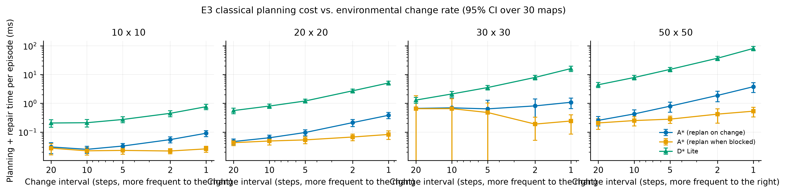
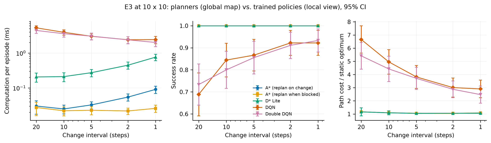

### Crossover (computation only, CPU inference vs CPU planning, GPU training)

| change every k | planner | RL | C_train s | c_plan ms/ep | c_infer ms/ep | H* episodes | planner success | RL success |
|---|---|---|---|---|---|---|---|---|
| 1 | A* (replan on change) | DQN | 1,103 | 0.091 | 2.42 | never | 1 | 0.922 |
| 1 | A* (replan on change) | Double DQN | 532 | 0.091 | 2.01 | never | 1 | 0.933 |
| 1 | A* (replan when blocked) | DQN | 1,103 | 0.026 | 2.42 | never | 1 | 0.922 |
| 1 | A* (replan when blocked) | Double DQN | 532 | 0.026 | 2.01 | never | 1 | 0.933 |
| 1 | D* Lite | DQN | 1,103 | 0.763 | 2.42 | never | 1 | 0.922 |
| 1 | D* Lite | Double DQN | 532 | 0.763 | 2.01 | never | 1 | 0.933 |
| 2 | A* (replan on change) | DQN | 1,103 | 0.0547 | 2.4 | never | 1 | 0.922 |
| 2 | A* (replan on change) | Double DQN | 532 | 0.0547 | 2.39 | never | 1 | 0.911 |
| 2 | A* (replan when blocked) | DQN | 1,103 | 0.022 | 2.4 | never | 1 | 0.922 |
| 2 | A* (replan when blocked) | Double DQN | 532 | 0.022 | 2.39 | never | 1 | 0.911 |
| 2 | D* Lite | DQN | 1,103 | 0.449 | 2.4 | never | 1 | 0.922 |
| 2 | D* Lite | Double DQN | 532 | 0.449 | 2.39 | never | 1 | 0.911 |
| 5 | A* (replan on change) | DQN | 1,103 | 0.0327 | 3.02 | never | 1 | 0.867 |
| 5 | A* (replan on change) | Double DQN | 532 | 0.0327 | 3.04 | never | 1 | 0.856 |
| 5 | A* (replan when blocked) | DQN | 1,103 | 0.023 | 3.02 | never | 1 | 0.867 |
| 5 | A* (replan when blocked) | Double DQN | 532 | 0.023 | 3.04 | never | 1 | 0.856 |
| 5 | D* Lite | DQN | 1,103 | 0.274 | 3.02 | never | 1 | 0.867 |
| 5 | D* Lite | Double DQN | 532 | 0.274 | 3.04 | never | 1 | 0.856 |
| 10 | A* (replan on change) | DQN | 1,103 | 0.0251 | 3.93 | never | 1 | 0.844 |
| 10 | A* (replan on change) | Double DQN | 532 | 0.0251 | 3.58 | never | 1 | 0.8 |
| 10 | A* (replan when blocked) | DQN | 1,103 | 0.0223 | 3.93 | never | 1 | 0.844 |
| 10 | A* (replan when blocked) | Double DQN | 532 | 0.0223 | 3.58 | never | 1 | 0.8 |
| 10 | D* Lite | DQN | 1,103 | 0.212 | 3.93 | never | 1 | 0.844 |
| 10 | D* Lite | Double DQN | 532 | 0.212 | 3.58 | never | 1 | 0.8 |
| 20 | A* (replan on change) | DQN | 1,103 | 0.0303 | 5.27 | never | 1 | 0.689 |
| 20 | A* (replan on change) | Double DQN | 532 | 0.0303 | 4.44 | never | 1 | 0.733 |
| 20 | A* (replan when blocked) | DQN | 1,103 | 0.0276 | 5.27 | never | 1 | 0.689 |
| 20 | A* (replan when blocked) | Double DQN | 532 | 0.0276 | 4.44 | never | 1 | 0.733 |
| 20 | D* Lite | DQN | 1,103 | 0.207 | 5.27 | never | 1 | 0.689 |
| 20 | D* Lite | Double DQN | 532 | 0.207 | 4.44 | never | 1 | 0.733 |

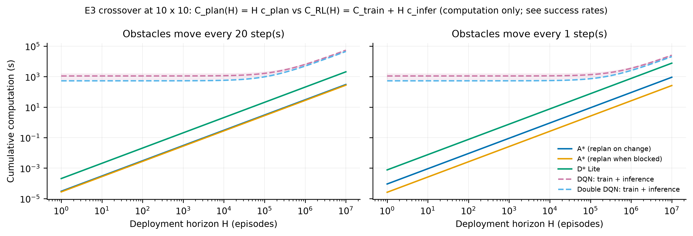
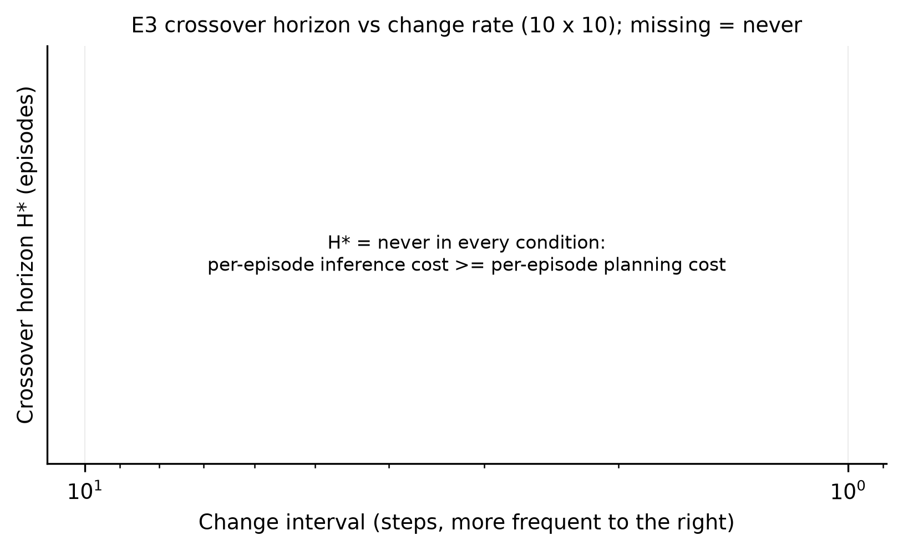

### Per-decision cost vs grid size

CNN forward-pass times use untrained networks of the DQN architecture. They measure inference *cost* only.
No generalist DQN was trained at N > 10, so policy success at those sizes is **pending**.

| grid_size | parameters | infer_ms |
|---|---|---|
| 10 | 1696004 | 0.127 |
| 20 | 467204 | 0.0914 |
| 30 | 1106180 | 0.152 |
| 50 | 2416900 | 0.347 |

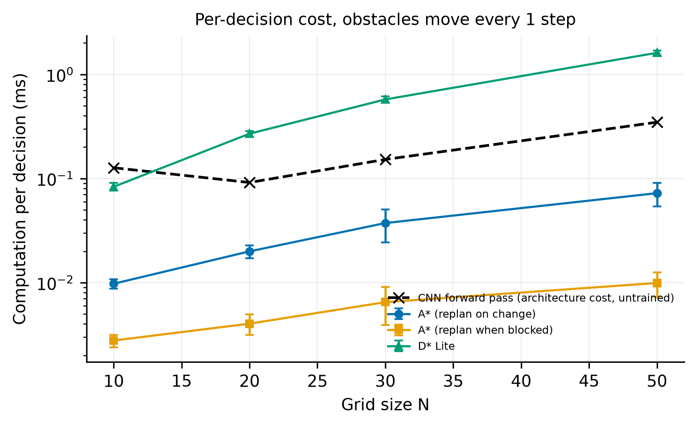

## E4: Stochastic transitions

| N | slip | method | success | return | collisions | path deviation | n |
|---|---|---|---|---|---|---|---|
| 10 | 0.0 | A* (replan) | 1 [1, 1] | 92 [90.9, 93.1] | 0 [0, 0] | 0 [0, 0] | 30 |
| 10 | 0.0 | D* Lite | 1 [1, 1] | 92 [90.9, 93.1] | 0 [0, 0] | 0 [0, 0] | 30 |
| 10 | 0.0 | DQN | 0.344 [0.244, 0.445] | -207 [-425, 11.4] | 2.2 [-2.17, 6.57] | 1.03 [0.573, 1.49] | 90 |
| 10 | 0.0 | Double DQN | 0.433 [0.329, 0.538] | -73.3 [-104, -42.8] | 0 [0, 0] | 0.769 [0.417, 1.12] | 90 |
| 10 | 0.0 | Q-Learning | 1 [1, 1] | 92 [90.9, 93.1] | 0 [0, 0] | 0 [0, 0] | 30 |
| 10 | 0.0 | Value Iteration | 1 [1, 1] | 92 [90.9, 93.1] | 0 [0, 0] | 0 [0, 0] | 30 |
| 10 | 0.1 | A* (replan) | 1 [1, 1] | 77.1 [72.6, 81.5] | 0.278 [0.206, 0.351] | 1.02 [0.851, 1.19] | 30 |
| 10 | 0.1 | D* Lite | 1 [1, 1] | 77.1 [72.6, 81.6] | 0.277 [0.203, 0.35] | 1.03 [0.86, 1.21] | 30 |
| 10 | 0.1 | DQN | 0.739 [0.661, 0.816] | -175 [-395, 45.8] | 3.42 [-0.944, 7.78] | 42.9 [33.8, 51.9] | 90 |
| 10 | 0.1 | Double DQN | 0.824 [0.753, 0.895] | -21.2 [-55.3, 12.8] | 0.834 [0.462, 1.21] | 34.8 [25.9, 43.8] | 90 |
| 10 | 0.1 | Q-Learning | 1 [1, 1] | 83.5 [80.3, 86.7] | 0.115 [0.0638, 0.166] | 2.75 [2.09, 3.41] | 30 |
| 10 | 0.1 | Value Iteration | 1 [1, 1] | 84.5 [81.6, 87.4] | 0.125 [0.0804, 0.17] | 1.23 [0.977, 1.48] | 30 |
| 10 | 0.2 | A* (replan) | 1 [1, 1] | 56 [48.3, 63.6] | 0.672 [0.538, 0.805] | 2.46 [2.12, 2.8] | 30 |
| 10 | 0.2 | D* Lite | 1 [1, 1] | 55.4 [47.6, 63.2] | 0.683 [0.547, 0.82] | 2.46 [2.13, 2.78] | 30 |
| 10 | 0.2 | DQN | 0.813 [0.747, 0.88] | -206 [-424, 11] | 4.48 [0.207, 8.76] | 34.9 [27.4, 42.5] | 90 |
| 10 | 0.2 | Double DQN | 0.873 [0.814, 0.932] | -43.4 [-93.9, 7.05] | 1.62 [0.84, 2.4] | 28.6 [21.4, 35.9] | 90 |
| 10 | 0.2 | Q-Learning | 0.998 [0.995, 1] | 66.2 [57.9, 74.5] | 0.32 [0.188, 0.452] | 9.35 [6.05, 12.6] | 30 |
| 10 | 0.2 | Value Iteration | 1 [1, 1] | 73.7 [68.3, 79.1] | 0.275 [0.185, 0.365] | 4.51 [3.63, 5.38] | 30 |
| 20 | 0.0 | A* (replan) | 1 [1, 1] | 81.5 [78.9, 84.1] | 0 [0, 0] | 0 [0, 0] | 30 |
| 20 | 0.0 | D* Lite | 1 [1, 1] | 81.5 [78.9, 84.1] | 0 [0, 0] | 0 [0, 0] | 30 |
| 20 | 0.0 | Q-Learning | 1 [1, 1] | 81.5 [78.9, 84.1] | 0 [0, 0] | 0 [0, 0] | 30 |
| 20 | 0.0 | Value Iteration | 1 [1, 1] | 81.5 [78.9, 84.1] | 0 [0, 0] | 0 [0, 0] | 30 |
| 20 | 0.1 | A* (replan) | 1 [1, 1] | 54.9 [46.9, 62.9] | 0.485 [0.377, 0.593] | 2.39 [2.05, 2.73] | 30 |
| 20 | 0.1 | D* Lite | 1 [1, 1] | 54.7 [46.8, 62.6] | 0.488 [0.382, 0.595] | 2.4 [2.07, 2.72] | 30 |
| 20 | 0.1 | Q-Learning | 0.967 [0.898, 1.03] | 27 [-36.9, 90.9] | 0.135 [0.0874, 0.183] | 19.2 [-6.07, 44.4] | 30 |
| 20 | 0.1 | Value Iteration | 1 [1, 1] | 68.7 [63.7, 73.6] | 0.207 [0.153, 0.261] | 2.54 [2.16, 2.92] | 30 |
| 20 | 0.2 | A* (replan) | 1 [1, 1] | 13.5 [-1.57, 28.6] | 1.25 [1.01, 1.5] | 5.33 [4.65, 6.01] | 30 |
| 20 | 0.2 | D* Lite | 1 [1, 1] | 14.3 [-1.23, 29.9] | 1.23 [0.979, 1.49] | 5.53 [4.88, 6.18] | 30 |
| 20 | 0.2 | Q-Learning | 0.998 [0.995, 1] | 32.8 [6.84, 58.8] | 0.443 [0.284, 0.603] | 25.5 [8.35, 42.7] | 30 |
| 20 | 0.2 | Value Iteration | 1 [1, 1] | 55.6 [47.4, 63.9] | 0.332 [0.223, 0.44] | 9.3 [8.05, 10.5] | 30 |

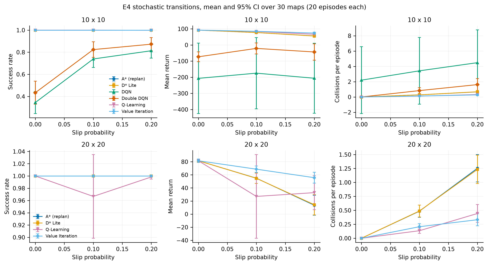

## E5: Generalization to unseen maps

| method | maps | success | cost / optimal (successes) | n |
|---|---|---|---|---|
| DQN | test (unseen) | 0.354 [0.298, 0.41] | 1.11 [1.07, 1.16] | 3 |
| DQN | train (seen) | 0.451 [0.318, 0.583] | 1.09 [1.07, 1.11] | 3 |
| Double DQN | test (unseen) | 0.405 [0.35, 0.459] | 1.08 [1.05, 1.11] | 3 |
| Double DQN | train (seen) | 0.532 [0.485, 0.579] | 1.07 [1.06, 1.08] | 3 |
| A* | test (unseen) | 1 | n/a | 500 |

Train/test map overlap: 0. For RL, n = training seeds; for A*, n = test maps.

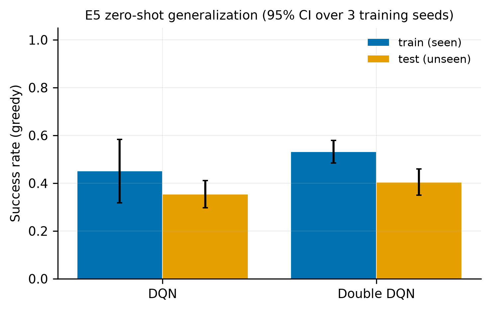

## E6: Convergence and learning-rate sensitivity

### Value Iteration (density 0.15; convergence = Bellman residual < theta)

| N | slip | sweeps | solve s | n |
|---|---|---|---|---|
| 10 | 0.0 | 19.1 [18.9, 19.3] | 0.000422 [0.000373, 0.00047] | 10 |
| 10 | 0.1 | 46.1 [45.1, 47.1] | 0.000953 [0.000945, 0.00096] | 10 |
| 10 | 0.2 | 74.9 [70.6, 79.2] | 0.00117 [0.00114, 0.00121] | 10 |
| 20 | 0.0 | 39 [39, 39] | 0.00189 [0.00187, 0.00191] | 10 |
| 20 | 0.1 | 74.2 [73.3, 75.1] | 0.00408 [0.00406, 0.00411] | 10 |
| 20 | 0.2 | 128 [119, 138] | 0.00525 [0.00504, 0.00546] | 10 |
| 30 | 0.0 | 59 [59, 59] | 0.00491 [0.00487, 0.00495] | 10 |
| 30 | 0.1 | 104 [102, 106] | 0.0101 [0.00995, 0.0102] | 10 |
| 30 | 0.2 | 161 [155, 166] | 0.0126 [0.0123, 0.0128] | 10 |
| 50 | 0.0 | 99 [99, 99] | 0.0177 [0.0176, 0.0178] | 10 |
| 50 | 0.1 | 164 [161, 168] | 0.0343 [0.0339, 0.0347] | 10 |
| 50 | 0.2 | 340 [307, 373] | 0.0545 [0.0508, 0.0583] | 10 |
| 70 | 0.0 | 139 [139, 140] | 0.0453 [0.0392, 0.0514] | 10 |
| 70 | 0.1 | 232 [213, 252] | 0.0798 [0.0757, 0.0839] | 10 |
| 70 | 0.2 | 636 [437, 835] | 0.165 [0.123, 0.207] | 10 |
| 100 | 0.0 | 199 [199, 199] | 0.112 [0.112, 0.113] | 10 |
| 100 | 0.1 | 544 [452, 635] | 0.295 [0.256, 0.334] | 10 |
| 100 | 0.2 | 1,194 [1,060, 1,329] | 0.573 [0.516, 0.631] | 10 |

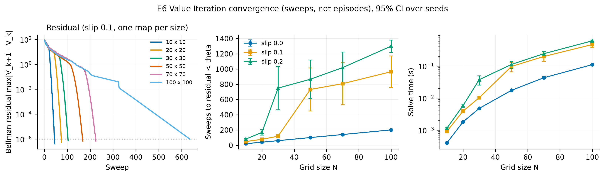

### Q-Learning, DQN, Double DQN (one fixed map per seed)

| algorithm | N | lr | converged fraction | episodes to conv. (converged runs) | final success | train s | n |
|---|---|---|---|---|---|---|---|
| double_dqn | 10 | 0.0001 | 1 | 280 [125, 435] | 0.667 [-0.768, 2.1] | 506 [502, 511] | 3 |
| double_dqn | 10 | 0.0005 | 0.667 | 235 [-210, 680] | 0.667 [-0.768, 2.1] | 508 [505, 510] | 3 |
| double_dqn | 10 | 0.001 | 0.667 | 320 [-824, 1,464] | 0.667 [-0.768, 2.1] | 507 [507, 508] | 3 |
| double_dqn | 10 | 0.005 | 0 | n/a | 0 [0, 0] | 507 [506, 508] | 3 |
| double_dqn | 20 | 0.0001 | 0.667 | 310 [-452, 1,072] | 0.333 [-1.1, 1.77] | 1,049 [1,047, 1,051] | 3 |
| double_dqn | 20 | 0.0005 | 0.333 | 350 | 0 [0, 0] | 1,051 [1,049, 1,052] | 3 |
| double_dqn | 20 | 0.001 | 0.333 | 220 | 0 [0, 0] | 1,051 [1,050, 1,052] | 3 |
| double_dqn | 20 | 0.005 | 0.333 | 250 | 0 [0, 0] | 1,051 [1,049, 1,053] | 3 |
| dqn | 10 | 0.0001 | 1 | 223 [195, 252] | 1 [1, 1] | 412 [407, 416] | 3 |
| dqn | 10 | 0.0005 | 1 | 333 [-3.94, 671] | 1 [1, 1] | 413 [411, 415] | 3 |
| dqn | 10 | 0.001 | 1 | 313 [-98.1, 725] | 1 [1, 1] | 412 [412, 413] | 3 |
| dqn | 10 | 0.005 | 1 | 407 [217, 596] | 0.667 [-0.768, 2.1] | 412 [411, 413] | 3 |
| dqn | 20 | 0.0001 | 0 | n/a | 0 [0, 0] | 782 [782, 783] | 3 |
| dqn | 20 | 0.0005 | 0 | n/a | 0.333 [-1.1, 1.77] | 783 [781, 785] | 3 |
| dqn | 20 | 0.001 | 0 | n/a | 0 [0, 0] | 782 [781, 783] | 3 |
| dqn | 20 | 0.005 | 0 | n/a | 0 [0, 0] | 782 [781, 783] | 3 |
| q_learning | 10 | 0.01 | 1 | 1,365 [891, 1,839] | 1 [1, 1] | 1.23 [1.17, 1.29] | 5 |
| q_learning | 10 | 0.05 | 1 | 425 [363, 487] | 1 [1, 1] | 1.13 [1.08, 1.17] | 5 |
| q_learning | 10 | 0.1 | 1 | 300 [238, 362] | 1 [1, 1] | 1.13 [1.08, 1.18] | 5 |
| q_learning | 10 | 0.3 | 1 | 205 [131, 279] | 1 [1, 1] | 1.11 [1.06, 1.16] | 5 |
| q_learning | 10 | 0.5 | 1 | 160 [99.5, 221] | 1 [1, 1] | 1.03 [0.903, 1.16] | 5 |
| q_learning | 20 | 0.01 | 0 | n/a | 0 [0, 0] | 7 [6.76, 7.25] | 5 |
| q_learning | 20 | 0.05 | 1 | 1,475 [1,351, 1,599] | 1 [1, 1] | 3.39 [3.32, 3.45] | 5 |
| q_learning | 20 | 0.1 | 1 | 715 [631, 799] | 1 [1, 1] | 3.09 [3.02, 3.15] | 5 |
| q_learning | 20 | 0.3 | 1 | 295 [228, 362] | 1 [1, 1] | 3.04 [2.96, 3.13] | 5 |
| q_learning | 20 | 0.5 | 1 | 280 [254, 306] | 1 [1, 1] | 3.01 [2.93, 3.09] | 5 |
| q_learning | 30 | 0.01 | 0 | n/a | 0 [0, 0] | 19 [18.5, 19.5] | 5 |
| q_learning | 30 | 0.05 | 0 | n/a | 0.2 [-0.355, 0.755] | 8.57 [8.31, 8.82] | 5 |
| q_learning | 30 | 0.1 | 1 | 1,675 [1,549, 1,801] | 1 [1, 1] | 6.38 [6.26, 6.49] | 5 |
| q_learning | 30 | 0.3 | 1 | 510 [449, 571] | 1 [1, 1] | 5.47 [5.33, 5.6] | 5 |
| q_learning | 30 | 0.5 | 1 | 355 [315, 395] | 1 [1, 1] | 5.33 [5.19, 5.47] | 5 |
| q_learning | 50 | 0.01 | 0 | n/a | 0 [0, 0] | 65.4 [64.3, 66.5] | 5 |
| q_learning | 50 | 0.05 | 0 | n/a | 0 [0, 0] | 33.1 [32.5, 33.7] | 5 |
| q_learning | 50 | 0.1 | 0 | n/a | 0 [0, 0] | 22.9 [22.5, 23.3] | 5 |
| q_learning | 50 | 0.3 | 1 | 1,575 [1,449, 1,701] | 1 [1, 1] | 14.2 [14.1, 14.4] | 5 |
| q_learning | 50 | 0.5 | 1 | 785 [721, 849] | 1 [1, 1] | 12.8 [12.6, 13.1] | 5 |
| q_learning | 70 | 0.01 | 0 | n/a | 0 [0, 0] | 157 [151, 162] | 5 |
| q_learning | 70 | 0.05 | 0 | n/a | 0 [0, 0] | 85.4 [82.6, 88.1] | 5 |
| q_learning | 70 | 0.1 | 0 | n/a | 0 [0, 0] | 60.2 [58.5, 61.9] | 5 |
| q_learning | 70 | 0.3 | 0 | n/a | 0 [0, 0] | 35.4 [34.1, 36.6] | 5 |
| q_learning | 70 | 0.5 | 1 | 1,815 [1,659, 1,971] | 1 [1, 1] | 28.9 [28, 29.9] | 5 |
| q_learning | 100 | 0.01 | 0 | n/a | 0 [0, 0] | 385 [379, 390] | 5 |
| q_learning | 100 | 0.05 | 0 | n/a | 0 [0, 0] | 225 [219, 231] | 5 |
| q_learning | 100 | 0.1 | 0 | n/a | 0 [0, 0] | 164 [161, 166] | 5 |
| q_learning | 100 | 0.3 | 0 | n/a | 0 [0, 0] | 97.6 [94.8, 100] | 5 |
| q_learning | 100 | 0.5 | 0 | n/a | 0 [0, 0] | 78.7 [76.2, 81.2] | 5 |

DQN / Double DQN at N = 30, 50, 70, 100: **pending** (not run, compute budget).

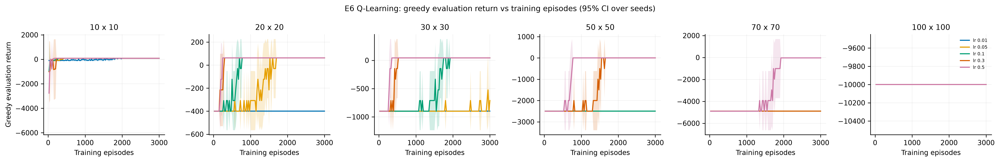
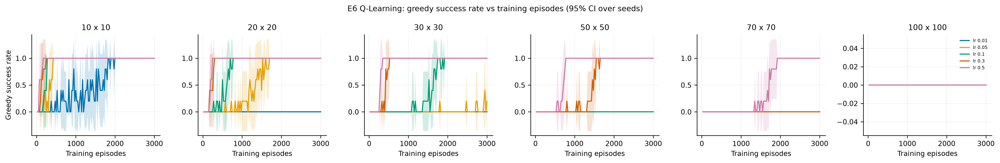
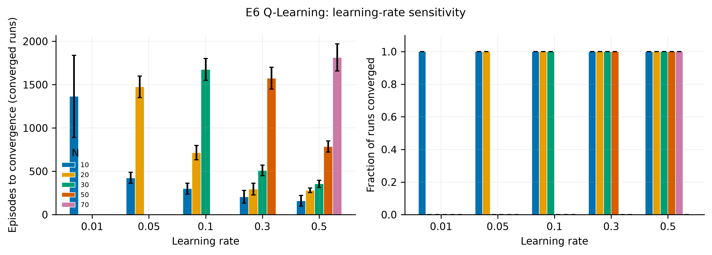
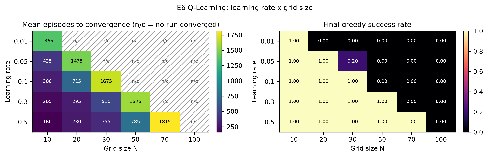
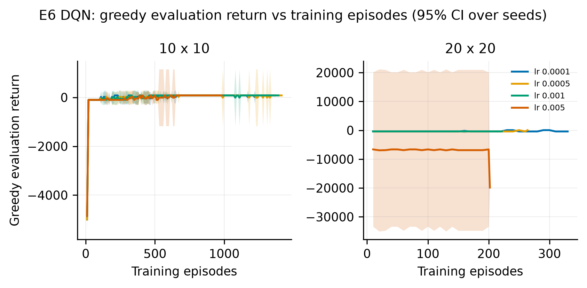
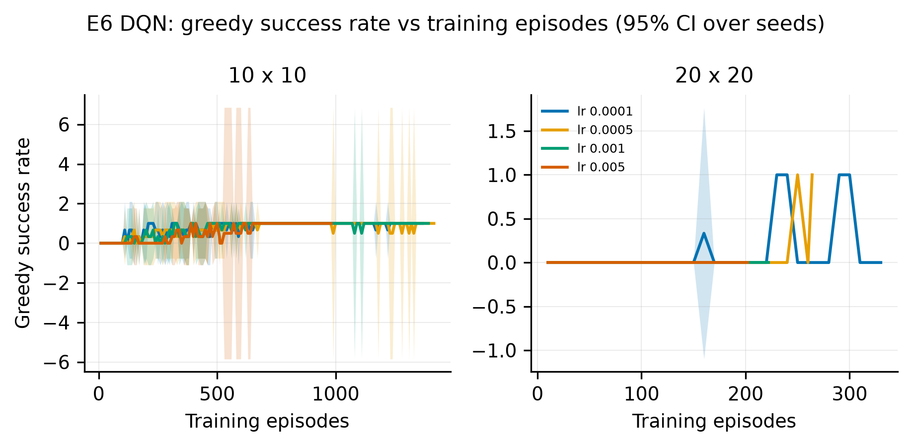
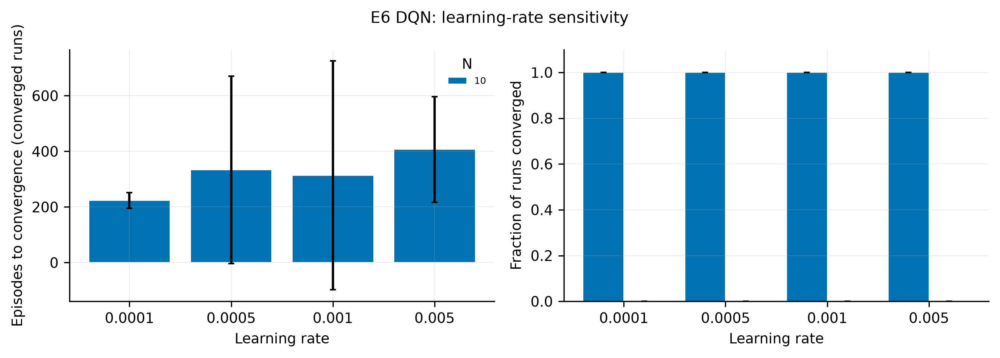
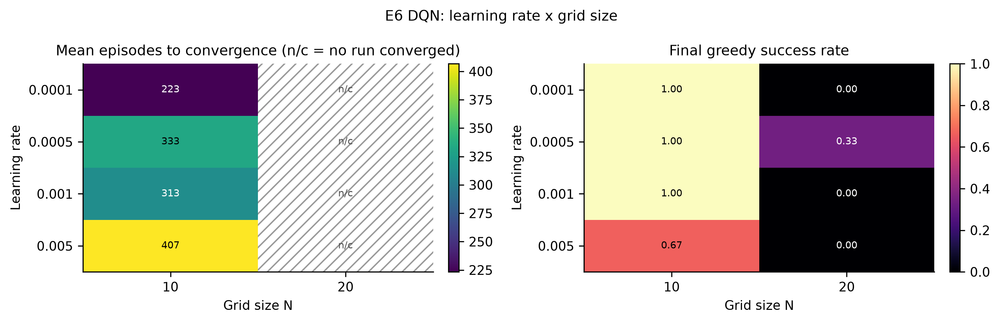
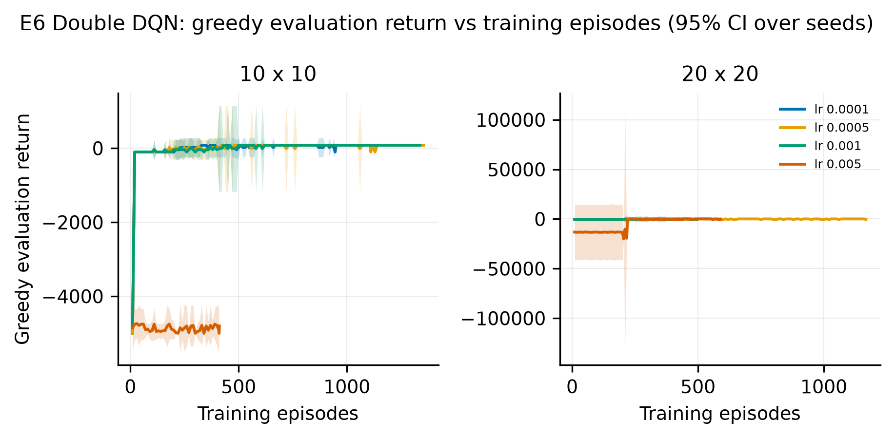
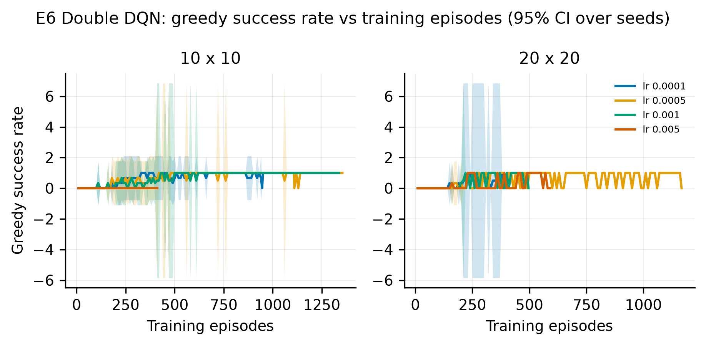
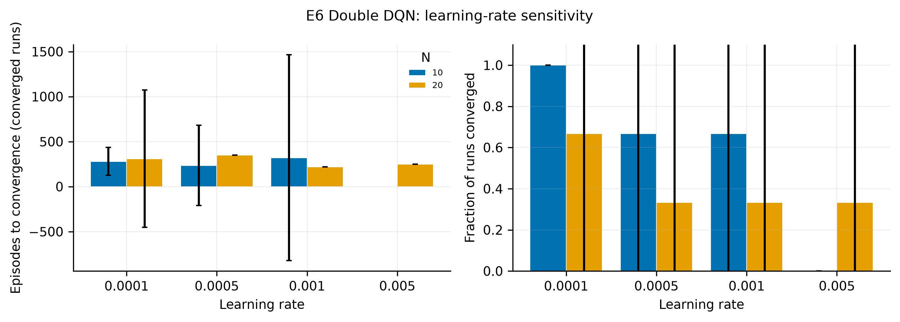
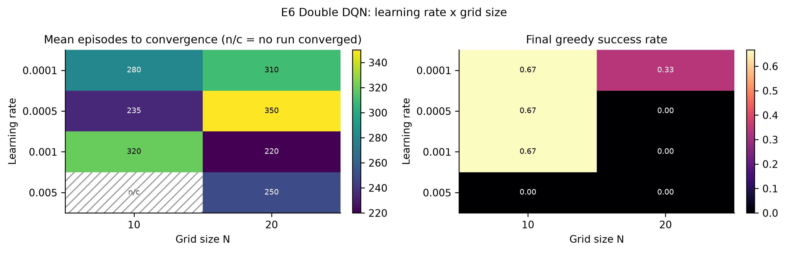
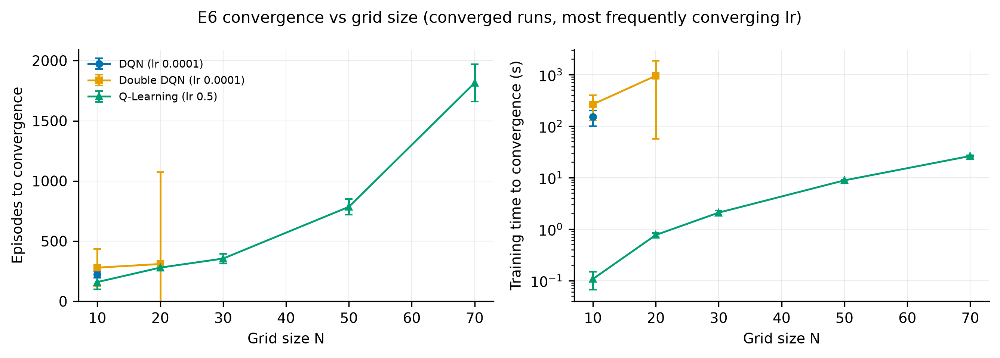

